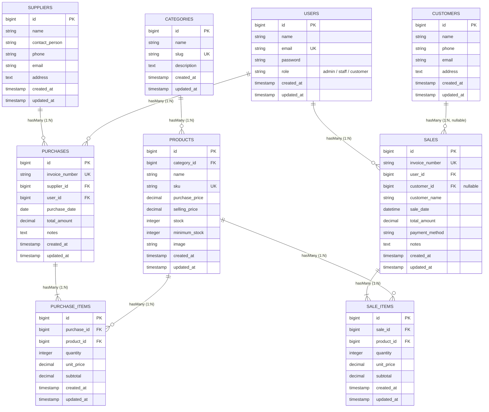
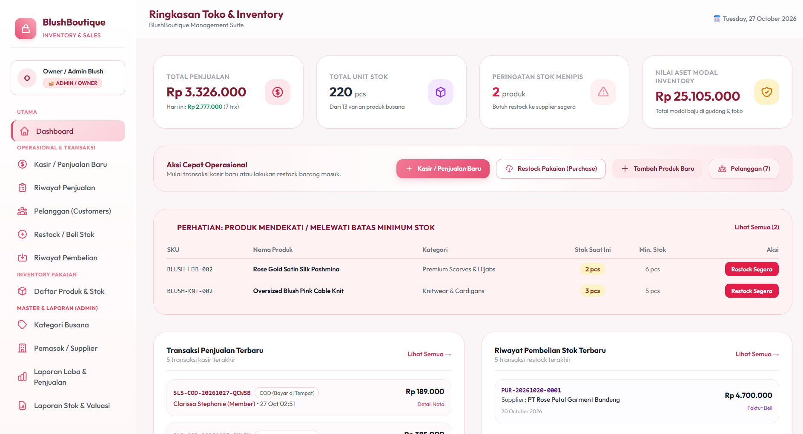
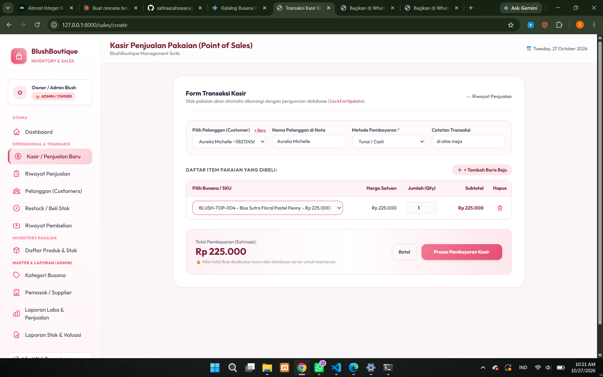
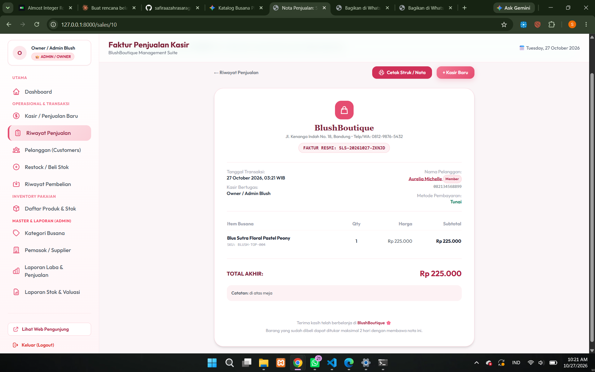

# Blush Boutique - Sistem Informasi Inventaris dan Penjualan (Point of Sales)

Dokumentasi Proyek Ujian Tengah Semester (UTS)  
Mata Kuliah: Web Programming 2  
Program Studi: Teknik Informatika / Sistem Informasi  

---

## 1. Project Overview

### Deskripsi Sistem
Blush Boutique adalah aplikasi sistem informasi berbasis web yang mengintegrasikan manajemen persediaan (*inventory*) dan transaksi kasir (*point of sales*) untuk operasional butik busana wanita. Perangkat lunak ini dikembangkan menggunakan framework Laravel 10 dan PHP 8.1+ dengan dukungan basis data relasional MySQL atau SQLite.

Aplikasi ini menerapkan prinsip rekayasa perangkat lunak standar:
- **Arsitektur Model-View-Controller (MVC)**: Menjamin pemisahan logika penanganan data, alur bisnis (*business logic*), dan antarmuka pengguna.
- **Eloquent Object-Relational Mapping (ORM)**: Mengelola pemetaan skema basis data relasional ke dalam objek model yang terstruktur dan aman dari SQL Injection.
- **Role-Based Access Control (RBAC)**: Membatasi hak akses pengguna ke dalam tiga tingkatan peran, yaitu Admin (Owner), Staff (Kasir), dan Customer (Member Pelanggan).
- **Desain Antarmuka Pengguna**: Menggunakan palet warna pastel (*blush pink*, *light blue*, dan *soft green*) melalui Tailwind CSS untuk menjaga konsistensi visual aplikasi.

### Latar Belakang Masalah
Pengelolaan inventaris pakaian pada operasional retail fisik sering mengalami kendala teknis dan operasional:
1. **Ketidaksesuaian Data Stok Fisik**: Pencatatan mutasi barang manual sering kali menyebabkan perbedaan kuantitas antara fisik pakaian di gudang/toko dan catatan pembukuan.
2. **Penjualan Barang Habis (*Out-of-Stock Sale*)**: Ketiadaan validasi ketersediaan barang secara terpusat pada saat transaksi kasir menyebabkan produk yang kuantitasnya nol tetap dapat diproses.
3. **Pencampuran Otoritas Pengguna**: Ketiadaan segmentasi hak akses menyebabkan staf operasional kasir dapat mengakses data finansial strategis, seperti harga pokok penjualan (HPP), margin laba kotor, dan konfigurasi master data.

### Tujuan Sistem
Sistem ini dirancang untuk mencapai sasaran teknis berikut:
- Mengelola seluruh master data (kategori, produk pakaian, pemasok, dan pelanggan) dalam satu basis data terpusat.
- Mengotomatisasi pembaruan stok secara konsisten: penambahan stok saat transaksi pembelian (*stock-in*) dan pengurangan stok saat transaksi penjualan (*stock-out*).
- Menjaga integritas data transaksi dan konkurensi data melalui penerapan mekanisme transaksi basis data (*database transaction*) dan penguncian baris (*row-level locking*).
- Menegakkan keamanan akses modul melalui pemisahan peran pengguna menggunakan middleware otorisasi.

---

## 2. Requirements

Sebelum melakukan instalasi, pastikan lingkungan server lokal memenuhi spesifikasi teknis berikut:

| Komponen | Spesifikasi Minimum | Keterangan |
| :--- | :--- | :--- |
| PHP | Versi 8.1 atau lebih tinggi | Ekstensi wajib: `pdo_mysql`, `pdo_sqlite`, `curl`, `mbstring`, `openssl`, `fileinfo`, `tokenizer` |
| Composer | Versi 2.2 atau lebih tinggi | Pengelola dependensi paket PHP |
| Node.js & NPM | Node.js versi 18.x dan NPM 9.x | Alat kompilasi aset front-end (Vite) |
| Web Server | Apache, Nginx, atau PHP Built-in Server | Server eksekusi aplikasi |
| Basis Data | MySQL versi 8.0 / MariaDB 10.4 atau SQLite 3.35 | Sistem manajemen basis data relasional |

---

## 3. Installation

Langkah-langkah pengunduhan dan instalasi dependensi backend aplikasi:

1. Kloning repositori kode sumber dari Git:
   ```bash
   git clone https://github.com/safiraazahrasaragih43-cloud/uts-inventory-sales.git
   cd uts-inventory-sales
   ```

2. Pasang seluruh dependensi PHP menggunakan Composer:
   ```bash
   composer install
   ```

---

## 4. Environment Setup

1. Salin berkas templat konfigurasi lingkungan:
   ```bash
   cp .env.example .env
   ```
   *(Pada sistem operasi Windows Command Prompt, gunakan perintah `copy .env.example .env`)*.

2. Buat kunci enkripsi unik aplikasi Laravel:
   ```bash
   php artisan key:generate
   ```

3. Konfigurasi kredensial basis data pada berkas `.env`:

   - **Konfigurasi SQLite (Default)**:
     ```ini
     DB_CONNECTION=sqlite
     ```

   - **Konfigurasi MySQL**:
     ```ini
     DB_CONNECTION=mysql
     DB_HOST=127.0.0.1
     DB_PORT=3306
     DB_DATABASE=blush_boutique_db
     DB_USERNAME=root
     DB_PASSWORD=
     ```
     *(Pastikan basis data `blush_boutique_db` telah dibuat terlebih dahulu di MySQL)*.

4. Buat tautan simbolik direktori penyimpanan berkas publik:
   ```bash
   php artisan storage:link
   ```

---

## 5. Migration & Seeding

Jalankan perintah migrasi skema tabel dan seeder data awal untuk menginisialisasi basis data:

```bash
php artisan migrate --seed
```

Untuk mereset seluruh tabel dan memuat kembali data contoh ke kondisi awal:

```bash
php artisan migrate:fresh --seed
```

---

## 6. Demo Account

Sistem menyediakan tiga akun uji dengan hak akses berbeda untuk keperluan evaluasi sistem:

| Peran (Role) | Nama Pengguna | Alamat Email | Password | Cakupan Hak Akses |
| :--- | :--- | :--- | :--- | :--- |
| Admin / Owner | Owner / Admin Blush | `admin@blushboutique.com` | `password123` | Akses penuh: manajemen Master Data (Kategori, Produk, Supplier, Customer), Laporan Keuangan Penjualan & Laba, Laporan Valuasi Aset Stok, serta Transaksi Kasir dan Restock. |
| Staff Kasir | Staff Kasir Blush | `staff@blushboutique.com` | `password123` | Akses operasional: Transaksi Penjualan Kasir (POS), Transaksi Pembelian Stok Masuk, melihat katalog busana dan data pelanggan. Dibatasi secara ketat dari menu Master Data dan Laporan Laba (HTTP 403 Forbidden). |
| Customer Member | Clarissa Stephanie (Member) | `customer@blushboutique.com` | `password123` | Akses member pelanggan: Portal dashboard pelanggan, kartu status member VIP, riwayat transaksi belanja pribadi, melihat struk nota pembelian, dan cek katalog busana. Dibatasi dari operasional kasir, pembelian supplier, master data, dan laporan laba (HTTP 403 Forbidden). |

---

## 7. Features

Aplikasi ini mencakup fitur-fitur fungsional berikut:

1. **Autentikasi dan Otorisasi (RBAC)**:
   - Mekanisme login aman menggunakan algoritma hashing password Bcrypt.
   - Pengecekan peran pengguna melalui `RoleMiddleware` untuk membatasi akses URL berdasarkan peran yang terdaftar.
   - Pembatasan akses langsung ke rute administratif untuk akun berstatus staf kasir.

2. **Manajemen Master Data (CRUD)**:
   - **Kategori Busana**: Pengelolaan kategori produk pakaian dengan pembuatan slug URL otomatis.
   - **Produk Pakaian**: Pengelolaan data produk mencakup kode unik SKU, nama, kategori, harga beli, harga jual, kuantitas stok fisik, batas stok minimum, dan unggah foto produk.
   - **Pemasok (Suppliers)**: Pengelolaan informasi kontak distributor/pemasok pakaian (nama perwakilan, nomor telepon, email, alamat).
   - **Pelanggan (Customers)**: Pengelolaan data identitas pelanggan member dan halaman rekap riwayat belanja.

3. **Transaksi Pembelian Stok (Purchase / Stock-In)**:
   - Pencatatan faktur pembelian barang masuk dari pemasok ke gudang.
   - Penambahan jumlah unit stok pakaian secara otomatis (*stock increment*).

4. **Transaksi Penjualan Kasir (Sales / Point of Sales / Stock-Out)**:
   - Antarmuka kasir untuk pencatatan transaksi pembelian pelanggan tetap maupun pelanggan umum (*walk-in customer*).
   - Dukungan pencatatan metode pembayaran (Tunai, QRIS, Transfer Bank, Kartu Debit/Kredit).
   - Pembuatan dan pencetakan faktur nota transaksi dalam format cetak standar (*print layout*).

5. **Integritas Transaksi dan Validasi Stok Otomatis**:
   - Seluruh mutasi transaksi dibungkus dalam blok `DB::transaction()` untuk memenuhi kriteria ACID.
   - Pencegahan kondisi balapan (*race condition*) melalui penguncian baris data produk menggunakan klausa `lockForUpdate()` saat evaluasi stok berlangsung.
   - Validasi ketersediaan stok di sisi server: transaksi kasir ditolak secara otomatis apabila kuantitas permintaan melebihi kuantitas stok fisik yang tersedia.
   - Perhitungan harga subtotal dan total nilai transaksi dihitung murni di sisi server untuk mencegah manipulasi data dari sisi klien.

6. **Dashboard Monitoring dan Notifikasi Stok**:
   - Ringkasan indikator kinerja utama (*Key Performance Indicators*): omset penjualan hari ini, total penjualan akumulatif, total unit persediaan, dan total valuasi modal stok produk (khusus peran Admin).
   - Peringatan stok menipis (*low stock alert*) untuk produk yang kuantitasnya berada di bawah atau sama dengan ambang batas stok minimum.
   - Log ringkas lima transaksi penjualan dan pembelian terakhir.

7. **Pencarian, Filter, dan Pagination**:
   - Fitur pencarian data menggunakan kata kunci nama pakaian, nomor SKU, nomor faktur, atau nama pelanggan.
   - Filter transaksi berdasarkan metode pembayaran dan rentang tanggal.
   - Pembagian halaman (*pagination*) data pada seluruh tabel master dan riwayat transaksi.

8. **Katalog Publik dan Pemesanan Terintegrasi**:
   - Halaman etalase katalog busana yang dapat diakses oleh pengunjung umum tanpa autentikasi melalui rute utama (`/`).
   - Tautan pemesanan langsung yang terintegrasi dengan protokol perpesanan WhatsApp.

---

## 8. Known Limitations

Batasan sistem yang diidentifikasi pada implementasi saat ini:
1. **Ketiadaan Integrasi Payment Gateway Pihak Ketiga**: Verifikasi pembayaran non-tunai (Transfer, QRIS, Kartu Debit) saat ini dilakukan secara manual/administratif oleh kasir, belum terhubung langsung ke API penyedia layanan gerbang pembayaran otomatis.
2. **Arsitektur Gudang Tunggal (*Single-Warehouse*)**: Struktur persediaan dirancang untuk operasional satu toko fisik tunggal, belum mendukung manajemen transfer stok antarcabang atau pergudangan multi-lokasi.
3. **Mekanisme Notifikasi Terbatas pada Antarmuka Web**: Peringatan stok kritis hanya disajikan secara visual pada antarmuka dashboard, belum terhubung ke sistem pengiriman notifikasi otomatis via SMS Gateway atau email.
4. **Alur Pengembalian Barang (*Return*) Manual**: Proses retur atau penukaran barang masih ditangani melalui penyesuaian administratif manual oleh petugas, belum memiliki modul alur otorisasi pengembalian barang (*Return Merchandise Authorization* / RMA) tersendiri.

---

## Urutan Lengkap Perintah Terminal (Reproducible Setup)

Berikut adalah satu blok kode perintah terminal yang dapat dieksekusi secara berurutan untuk memasang dan menjalankan sistem dari kondisi awal:

```bash
# 1. Kloning repositori proyek dari GitHub
git clone https://github.com/safiraazahrasaragih43-cloud/uts-inventory-sales.git

# 2. Masuk ke direktori proyek
cd uts-inventory-sales

# 3. Instalasi seluruh paket dependensi backend PHP
composer install

# 4. Pembuatan berkas konfigurasi lingkungan
cp .env.example .env

# 5. Pembuatan kunci enkripsi aplikasi
php artisan key:generate

# 6. Pembuatan tautan simbolik direktori penyimpanan publik
php artisan storage:link

# 7. Eksekusi migrasi skema basis data dan pengisian data contoh
php artisan migrate --seed

# 8. Instalasi dependensi front-end dan build aset
npm install
npm run build

# 9. Menjalankan server aplikasi lokal
php artisan serve
```

Aplikasi dapat diakses melalui browser pada alamat: **http://localhost:8000**

---

## Database Schema (ERD)

### Visualisasi Entity Relationship Diagram




### Relasi Antar Tabel (Eloquent ORM)

- **`Category hasMany Products` (`Product belongsTo Category`)**: Satu kategori busana berelasi satu-ke-banyak dengan entitas produk pakaian.
- **`Supplier hasMany Purchases` (`Purchase belongsTo Supplier`)**: Satu pemasok berelasi satu-ke-banyak dengan transaksi pembelian barang masuk.
- **`User hasMany Sales` & `User hasMany Purchases`**: Mengasosiasikan pengguna yang bertindak sebagai operator transaksi penjualan atau pencatat pembelian stok.
- **`Customer hasMany Sales` (`Sale belongsTo Customer`)**: Setiap pelanggan member dapat memiliki banyak transaksi penjualan. Kolom `customer_id` pada tabel `sales` bersifat `nullable` (`nullOnDelete`) untuk memfasilitasi transaksi pelanggan umum non-member (*walk-in customer*).
- **`Sale hasMany SaleItems` (`SaleItem belongsTo Sale`)**: Satu transaksi penjualan menampung rincian beberapa baris barang yang terjual.
- **`Purchase hasMany PurchaseItems` (`PurchaseItem belongsTo Purchase`)**: Satu faktur pembelian menampung rincian beberapa baris barang yang direstock dari pemasok.
- **`Product hasMany SaleItems` & `Product hasMany PurchaseItems`**: Setiap produk pakaian terhubung dengan baris rincian keluar dan masuk persediaan.

---

## Application Screenshots

### 1. Dashboard Utama dan Indikator Stok


### 2. Transaksi Kasir dan Cetak Struk Penjualan




---

## Pengujian Unit dan Fitur (PHPUnit)

Pengujian perangkat lunak dilakukan menggunakan suite pengujian otomatis PHPUnit:

```bash
php artisan test
```

Hasil pengujian fitur:
```text
   PASS  Tests\Unit\ExampleTest
  - that true is true

   PASS  Tests\Feature\BlushBoutiqueTest
  - public catalog accessible without login
  - public product detail page
  - admin can login and access dashboard
  - staff cannot access categories or reports (Security 403)
  - sale transaction decrements stock and rejects insufficient stock
  - purchase transaction increments stock
  - admin can upload product with image

   PASS  Tests\Feature\CustomerTest
  - authenticated user can view customers list
  - authenticated user can view customer details
  - can create new customer
  - can update customer
  - can delete customer
  - sale transaction with registered customer
  - sale transaction with walk in customer

   PASS  Tests\Feature\ExampleTest
  - the application returns a successful response

  Tests:    16 passed (65 assertions)
  Duration: 1.98s
```

---

## Lisensi dan Hak Cipta

Dokumentasi dan kode sumber aplikasi ini disusun untuk keperluan pemenuhan Ujian Tengah Semester (UTS) mata kuliah Web Programming 2. Hak Cipta (c) 2026 Blush Boutique Web.
