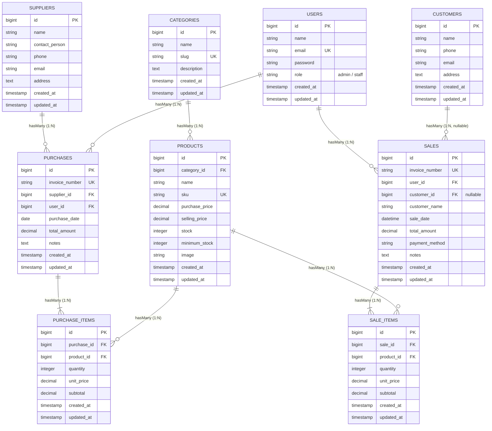

# 🌸 Blush Boutique — Sistem Informasi Inventaris & Penjualan (POS)

<p align="center">
  
  
  
  
  
</p>

---

> **Dokumentasi Proyek Ujian Tengah Semester (UTS)**  
> **Mata Kuliah:** Web Programming 2  
> **Aplikasi:** Sistem Informasi Inventaris dan Penjualan (Point of Sales)  
> **Tema Desain Antarmuka:** Pastel (*Blush Pink, Light Blue, Soft Green*)  

---

## 1. Project Overview

### 📖 Tentang Blush Boutique
**Blush Boutique** adalah aplikasi web Sistem Informasi Inventaris dan Penjualan (*Point of Sales* / POS) yang dirancang khusus untuk operasional toko dan butik pakaian wanita. Aplikasi ini dibangun menggunakan framework **Laravel 10**, bahasa pemrograman **PHP 8.1+**, serta basis data **MySQL / SQLite** dengan mengadopsi standar arsitektur perangkat lunak modern:
- **Model-View-Controller (MVC)**: Pemisahan logika bisnis, antarmuka pengguna, dan perutean data yang rapi dan terstruktur.
- **Eloquent ORM**: Pengelolaan relasi basis data relasional yang ekspresif, aman, dan efisien.
- **Autentikasi & Role-Based Access Control (RBAC)**: Mekanisme pembagian hak akses bertingkat antara dua peran utama, yaitu **Admin / Owner** dan **Staff Kasir**.
- **Tema Desain Visual Pastel**: Memadukan perpaduan warna lembut (*blush pink*, *light blue*, dan *soft green*) yang menghadirkan tampilan feminin, bersih, dan nyaman bagi staf toko maupun pengunjung etalase publik.

### 🔍 Latar Belakang Masalah
Dalam pengelolaan toko busana retail konvensional, pencatatan manual sering menghadapi kendala nyata:
1. **Ketidaksesuaian Stok Fisik vs Catatan**: Mutasi barang yang tidak terdata seketika menyebabkan perbedaan antara jumlah pakaian di rak fisik dan data buku stok.
2. **Produk Habis Masih Bisa Terjual**: Ketiadaan validasi ketersediaan barang secara *real-time* memungkinkan kasir menjual pakaian yang fisiknya telah habis, merugikan kepuasan pelanggan.
3. **Pencampuran Hak Akses Pengguna**: Tanpa adanya sistem RBAC, staf kasir memiliki akses bebas ke data modal, harga beli, dan laporan margin laba bersih toko yang seharusnya bersifat rahasia bagi pemilik usaha (*owner*).

### 🎯 Tujuan Sistem
Sistem Informasi **Blush Boutique** bertujuan untuk:
- Mencatat seluruh **Master Data** (Kategori, Produk Pakaian, Supplier, dan Pelanggan) secara terpusat dan konsisten.
- Mengotomatisasi siklus pergerakan barang: **Stock-in** saat pembelian restock dari supplier dan **Stock-out** saat transaksi kasir.
- Menjamin integritas data transaksi dan konsistensi stok menggunakan mekanisme **Database Transaction** (`DB::transaction`) dan penguncian baris produk (`lockForUpdate`).
- Mengamankan operasional toko dengan membatasi wewenang staf kasir murni pada transaksi harian dan menjaga modul manajerial hanya untuk pemilik toko.

---

## 2. Requirements

Pastikan lingkungan server lokal Anda memenuhi spesifikasi perangkat lunak berikut:

| Perangkat Lunak | Kebutuhan Minimum | Deskripsi / Fungsi |
| :--- | :--- | :--- |
| **PHP** | Versi `>= 8.1` | Ekstensi aktif: `pdo_mysql` / `pdo_sqlite`, `curl`, `mbstring`, `openssl`, `fileinfo`, `tokenizer` |
| **Composer** | Versi `>= 2.2` | Dependency Manager paket PHP Laravel |
| **Node.js & NPM** | Node `>= 18.x` & NPM `>= 9.x` | Compiler aset front-end (Vite & Tailwind CSS) |
| **Web Server** | Apache / Nginx / PHP Built-in | Server web lokal (contoh: `php artisan serve`) |
| **Database** | MySQL `>= 8.0` / MariaDB `>= 10.4` atau SQLite `>= 3.35` | Sistem Manajemen Basis Data Relasional |

---

## 3. Installation

Unduh kode sumber proyek dari repositori resmi dan pasang dependensi backend:

1. **Kloning Repositori**:
   ```bash
   git clone https://github.com/safiraazahrasaragih43-cloud/uts-inventory-sales.git
   cd uts-inventory-sales
   ```

2. **Pasang Dependensi PHP (Composer)**:
   ```bash
   composer install
   ```

---

## 4. Environment Setup

1. **Salin File Environment**:
   Salin berkas templat `.env.example` menjadi `.env`:
   ```bash
   cp .env.example .env
   ```
   *(Pada sistem operasi Windows Command Prompt, gunakan perintah `copy .env.example .env`)*.

2. **Generate Application Key**:
   Buat kunci enkripsi aplikasi Laravel yang unik:
   ```bash
   php artisan key:generate
   ```

3. **Konfigurasi Kredensial Basis Data di `.env`**:
   Buka file `.env` dan sesuaikan konfigurasi koneksi basis data yang Anda gunakan:

   - **Opsi A: Menggunakan SQLite (Rekomendasi Cepat & Portabel)**:
     ```ini
     DB_CONNECTION=sqlite
     ```
     *(Database SQLite akan otomatis dibuat dan siap pakai di `database/database.sqlite`)*.

   - **Opsi B: Menggunakan MySQL**:
     ```ini
     DB_CONNECTION=mysql
     DB_HOST=127.0.0.1
     DB_PORT=3306
     DB_DATABASE=blush_boutique_db
     DB_USERNAME=root
     DB_PASSWORD=
     ```
     *(Pastikan Anda telah membuat database bernama `blush_boutique_db` melalui phpMyAdmin atau MySQL CLI)*.

4. **Tautkan Storage Penyimpanan Foto Produk**:
   ```bash
   php artisan storage:link
   ```

---

## 5. Migration & Seeding

Jalankan perintah migrasi skema tabel serta pengisian data awal (*seeder*) untuk akun demo, kategori, supplier, produk pakaian awal, dan contoh transaksi:

```bash
php artisan migrate --seed
```

> [!TIP]
> Jika sewaktu-waktu Anda ingin mengembalikan basis data ke kondisi awal bersih (*fresh start*):
> ```bash
> php artisan migrate:fresh --seed
> ```

---

## 6. Demo Account

Tersedia akun pengujian standar dengan hak akses berbeda untuk keperluan evaluasi sistem:

| Peran (Role) | Nama Akun | Alamat Email | Password | Hak Akses Sistem |
| :--- | :--- | :--- | :--- | :--- |
| **👑 Admin / Owner** | Owner / Admin Blush | `admin@blushboutique.com` | `password123` | • Kendali penuh Master Data (Kategori, Produk, Supplier, Pelanggan)<br>• Akses Laporan Penjualan & Margin Laba Kotor Toko<br>• Akses Laporan Valuasi Nilai Persediaan Modal<br>• Transaksi Penjualan Kasir & Transaksi Restock |
| **🛍️ Staff Kasir** | Staff Kasir Blush | `staff@blushboutique.com` | `password123` | • Transaksi Penjualan Kasir Baru (*Point of Sales*)<br>• Transaksi Pembelian / Restock Pakaian Masuk<br>• Melihat Katalog Busana & Stok Fisik Tersedia<br>• Melihat Daftar Pelanggan<br>• *Ditolak otomatis (403 Forbidden) dari Master Data & Laporan Finansial* |

---

## 7. Features

Aplikasi **Blush Boutique** dilengkapi modul-modul fungsional berikut:

1. **🔐 Autentikasi & Role-Based Access Control (RBAC)**:
   - Login terenkripsi dengan proteksi Bcrypt hashing.
   - Pembedaan hak akses rute menggunakan [`RoleMiddleware`](app/Http/Middleware/RoleMiddleware.php).
   - Penolakan akses otomatis (*403 Forbidden*) jika Staff mencoba mengakses menu Admin.
2. **👗 Kelola Master Data Lengkap (CRUD)**:
   - **Kategori Pakaian**: Tambah, ubah, dan hapus kategori busana dengan auto-slug.
   - **Produk Busana**: Kelola busana lengkap dengan kode SKU unik, harga modal (beli), harga jual, stok fisik, batas minimum stok, dan unggah foto produk.
   - **Pemasok (Suppliers)**: Data identitas distributor busana, contact person, telepon, email, dan alamat.
   - **Pelanggan (Customers)**: Manajemen data member pelanggan dan halaman profil riwayat belanja.
3. **📥 Transaksi Pembelian (Purchase / Stock-In)**:
   - Faktur restock pasokan busana masuk dari supplier.
   - Menghitung subtotal secara otomatis dan menambah jumlah stok pakaian fisik di inventaris (*stock increment*).
4. **📤 Transaksi Penjualan Kasir (Sales / Stock-Out)**:
   - Form kasir POS interaktif dengan dukungan pembeli member maupun pembeli umum (*Walk-in Customer*).
   - Berbagai pilihan metode pembayaran: Tunai, QRIS, Transfer Bank, dan Debit/Kredit.
   - Fitur cetak struk/nota resmi yang rapi (*print layout ready*).
5. **⚡ Automatic Stock Updates & Data Integrity**:
   - Transaksi dibungkus dalam mekanisme `DB::transaction()` untuk menjamin konsistensi ACID.
   - Penguncian baris database menggunakan `Product::lockForUpdate()` untuk mencegah *race condition*.
   - **Validasi Stok Ketat**: Penjualan otomatis **ditolak** apabila jumlah permintaan melebihi kuantitas stok yang tersedia.
   - Kalkulasi harga dan subtotal dihitung murni di sisi server (*server-side calculation*), mencegah manipulasi input dari sisi browser client.
6. **📊 Dashboard Ringkas & Peringatan Stok**:
   - Kartu metrik KPI: Omset Penjualan Hari Ini, Total Akumulasi Omset, Total Fisik Stok Pakaian, dan Nilai Aset Modal Inventory (khusus Admin).
   - Indikator peringatan stok kritis (*Low Stock Alert*) untuk busana yang stoknya `<= minimum_stock`.
   - Feed riwayat transaksi terkini (penjualan kasir & restock barang masuk).
7. **🔍 Pencarian, Filter & Pagination**:
   - Pencarian cerdas berbasis kata kunci (nama baju, kode SKU, nomor faktur, atau nama pelanggan).
   - Filter transaksi kasir berdasarkan rentang tanggal dan metode pembayaran.
   - Penomoran halaman (*pagination*) di seluruh tabel untuk menjaga efisiensi rendering aplikasi.
8. **🛍️ Etalase Publik & Integrasi WhatsApp**:
   - Halaman katalog publik yang dapat diakses pengunjung tanpa perlu login pada rute utama (`/`).
   - Tombol pemesanan langsung yang otomatis terhubung ke WhatsApp toko dengan pesan pemesanan terformat.

---

## 8. Known Limitations

Beberapa batasan teknis dari sistem pada rilis ini:
1. **Belum Terintegrasi Payment Gateway Nyata**: Transaksi pembayaran non-tunai (QRIS/Transfer/Debit) saat ini dicatat secara konfirmasi administratif kasir dan belum terhubung ke API payment gateway pihak ketiga (seperti Midtrans atau Xendit).
2. **Cakupan Multi-Gudang Terbatas**: Sistem dikonfigurasi untuk operasional satu toko/butik fisik tunggal (*Single Warehouse/Store*) dan belum mendukung mutasi stok antar-cabang.
3. **Notifikasi Berbasis Tampilan Web**: Peringatan stok menipis disajikan secara visual melalui kartu alert pada dashboard aplikasi dan belum memiliki layanan pengiriman notifikasi otomatis via SMS Gateway atau push email.
4. **Alur Retur Barang Sederhana**: Pengembalian atau penukaran barang masih ditangani secara manual oleh kasir, belum memiliki modul terpisah untuk *Return Merchandising Authorization (RMA)*.

---

## ⚡ Urutan Lengkap Perintah Terminal (Reproducible Setup)

Berikut adalah satu blok kode perintah terminal yang dapat disalin dan dijalankan langsung oleh dosen penguji untuk memasang dan menjalankan proyek secara berurutan dari awal:

```bash
# 1. Kloning repositori proyek dari GitHub
git clone https://github.com/safiraazahrasaragih43-cloud/uts-inventory-sales.git

# 2. Masuk ke dalam direktori proyek
cd uts-inventory-sales

# 3. Pasang dependensi PHP melalui Composer
composer install

# 4. Buat berkas konfigurasi lingkungan (.env)
cp .env.example .env

# 5. Generate kunci enkripsi unik aplikasi Laravel
php artisan key:generate

# 6. Buat tautan simbolik direktori penyimpanan foto produk
php artisan storage:link

# 7. Eksekusi migrasi skema tabel database dan data awal (seeding)
php artisan migrate --seed

# 8. Pasang dependensi front-end dan lakukan build aset
npm install
npm run build

# 9. Jalankan server lokal Laravel
php artisan serve
```

> Akses aplikasi melalui web browser pada alamat: **[http://localhost:8000](http://localhost:8000)**.

---

## 🗄️ Database Schema (ERD)

### Visualisasi Entity Relationship Diagram




### Penjelasan Relasi Antar Tabel (Eloquent ORM)

- **`Category hasMany Products` (`Product belongsTo Category`)**: Satu kategori busana mengelompokkan banyak varian produk pakaian.
- **`Supplier hasMany Purchases` (`Purchase belongsTo Supplier`)**: Satu pemasok grosir dapat memiliki banyak riwayat transaksi faktur restock masuk.
- **`User hasMany Sales` & `User hasMany Purchases`**: Menghubungkan akun staf kasir/admin yang bertanggung jawab mencatat transaksi penjualan dan pembelian.
- **`Customer hasMany Sales` (`Sale belongsTo Customer`)**: Setiap pelanggan terdaftar dapat memiliki banyak riwayat transaksi. Relasi ini bersifat `nullable` (`nullOnDelete`) sehingga kasir tetap leluasa melayani pembeli langsung non-member (*Walk-in Customer*).
- **`Sale hasMany SaleItems` (`SaleItem belongsTo Sale`)**: Satu faktur penjualan kasir menampung rincian beberapa item busana yang terjual.
- **`Purchase hasMany PurchaseItems` (`PurchaseItem belongsTo Purchase`)**: Satu faktur restock menampung rincian beberapa item busana yang dibeli dari supplier.
- **`Product hasMany SaleItems` & `Product hasMany PurchaseItems`**: Setiap produk busana terhubung dengan riwayat keluar masuk kuantitas stoknya.

---

## 📸 Application Screenshots

### 1. Dashboard Utama & Indikator Stok


### 2. Transaksi Kasir & Cetak Struk Penjualan


---

## 🎨 Palet Warna Antarmuka (Aesthetic Soft Pastel)

- 🌸 **Blush Pink Primary**: `#F27893` / `#E54D71`
- 🍬 **Pastel Background**: `#FAF5F7` / `#FFF0F3`
- 🌊 **Light Blue & Cyan Accent**: `#EBF8FF` / `#3182CE`
- 🌿 **Soft Green & Mint**: `#F0FFF4` / `#38A169`
- ☕ **Luxury Slate Text**: `#372A31` / `#4A3B43`
- 🖋️ **Tipografi**: `Outfit` (Modern Clean Sans) & `Playfair Display` (Luxury Boutique Serif)

---

## 🧪 Hasil Pengujian Unit & Fitur (PHPUnit)

Pengujian fitur otomatis dijalankan untuk memverifikasi fungsionalitas logika transaksi dan keamanan:

```bash
php artisan test
```

```text
   PASS  Tests\Unit\ExampleTest
  ✓ that true is true

   PASS  Tests\Feature\BlushBoutiqueTest
  ✓ public catalog accessible without login
  ✓ public product detail page
  ✓ admin can login and access dashboard
  ✓ staff cannot access categories or reports (Security 403)
  ✓ sale transaction decrements stock and rejects insufficient stock
  ✓ purchase transaction increments stock
  ✓ admin can upload product with image

   PASS  Tests\Feature\CustomerTest
  ✓ authenticated user can view customers list
  ✓ authenticated user can view customer details
  ✓ can create new customer
  ✓ can update customer
  ✓ can delete customer
  ✓ sale transaction with registered customer
  ✓ sale transaction with walk in customer

   PASS  Tests\Feature\ExampleTest
  ✓ the application returns a successful response

  Tests:    16 passed (65 assertions)
  Duration: 1.98s
```

---

## 📄 Lisensi & Hak Cipta

Proyek ini dikembangkan untuk pemenuhan **Ujian Tengah Semester (UTS) mata kuliah Web Programming 2**.  
Hak Cipta &copy; 2026 **Blush Boutique Web**. Seluruh hak cipta dilindungi undang-undang.
