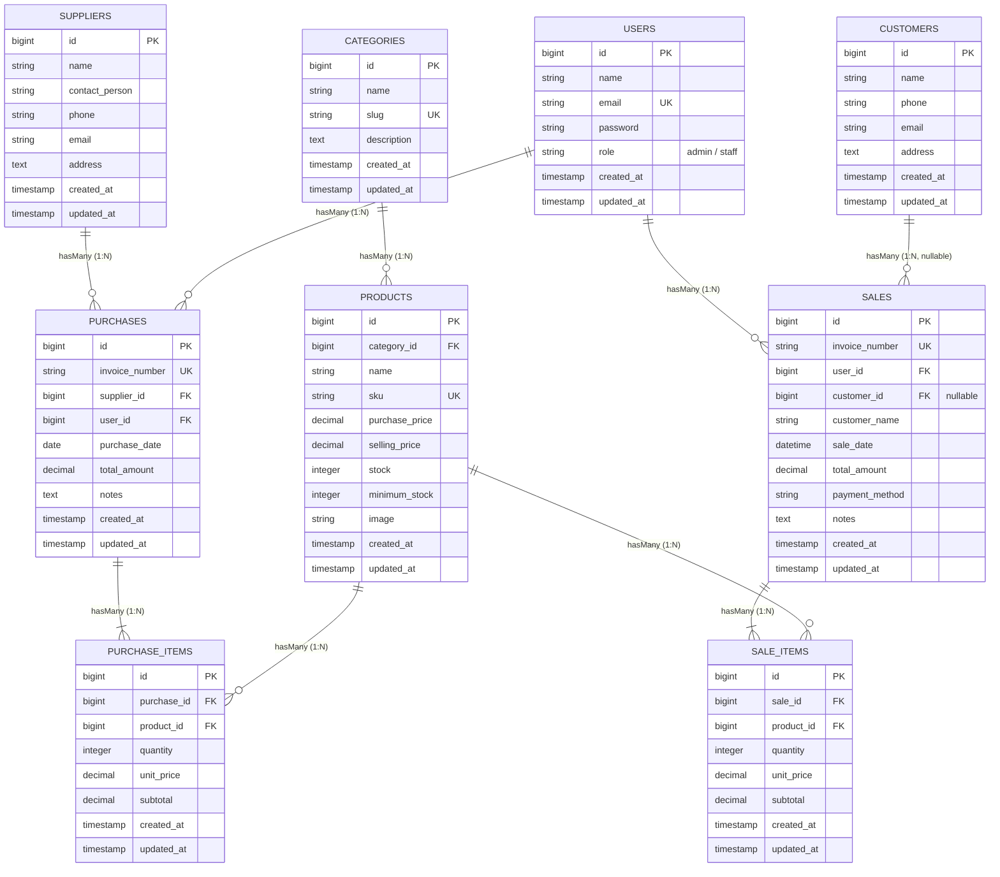

# 🌸 Blush Boutique — Sistem Informasi Inventaris & Penjualan (POS)

<p align="center">
  
  
  
  
  
</p>

---

> **Dokumentasi Proyek Ujian Tengah Semester (UTS)**  
> **Mata Kuliah:** Web Programming 2  
> **Topik:** Pengembangan Aplikasi Berbasis Web Menggunakan Framework PHP (Laravel 10)  
> **Tema UI:** Pastel Soft (*Blush Pink, Light Blue, Soft Green*)  

---

## 1. Project Overview

### 📖 Deskripsi Singkat
**Blush Boutique** adalah aplikasi web Sistem Informasi Inventaris dan Penjualan (*Point of Sales* / POS) yang dirancang khusus untuk memfasilitasi operasional toko dan butik pakaian wanita. Aplikasi ini mengimplementasikan konsep arsitektur **Model-View-Controller (MVC)**, manipulasi basis data menggunakan **Eloquent ORM**, mekanisme autentikasi terenkripsi, serta pembatasan akses berbasis peran (**Role-Based Access Control / RBAC**) yang memisahkan otoritas antara **Admin (Owner)** dan **Staff (Kasir)**. 

Secara visual, antarmuka aplikasi mengadopsi tema warna **pastel lembut** (*blush pink*, *light blue*, dan *soft green*) yang menghadirkan pengalaman visual bersih, estetis, dan nyaman bagi staf toko maupun pengunjung etalase publik.

### 🔍 Latar Belakang Masalah
Dalam operasional butik busana berskala kecil hingga menengah, pencatatan manual berbasis buku atau lembar kerja (*spreadsheet*) kerap memicu permasalahan krusial, antara lain:
1. **Ketidaksesuaian Stok Fisik dan Catatan**: Pergerakan keluar-masuk busana sering terlewat untuk dicatat, mengakibatkan selisih antara ketersediaan fisik di rak/gudang dan data pembukuan.
2. **Produk Habis Tetap Terjual**: Ketiadaan mekanisme validasi stok otomatis dan perlindungan transaksi (*concurrency lock*) menyebabkan staf kasir tetap dapat memproses penjualan atas pakaian yang stoknya sudah habis.
3. **Ketiadaan Pemisahan Otoritas (Hak Akses Campur Aduk)**: Seluruh staf kerap dapat melihat atau bahkan mengubah data modal, laporan margin keuntungan toko, dan master data produk tanpa pembatasan hak akses yang tegas.

### 🎯 Tujuan Sistem
Sistem Informasi **Blush Boutique** dikembangkan untuk:
- Mencatat seluruh **Master Data** (Kategori, Produk, Supplier, dan Pelanggan) secara terpusat, terstruktur, dan konsisten.
- Mengotomatisasi penambahan stok saat **Transaksi Pembelian (*Stock-in*)** dan pengurangan stok saat **Transaksi Penjualan (*Stock-out*)**.
- Menjamin konsistensi data melalui proteksi **Database Transaction** (`DB::transaction`) dan penguncian baris database (`lockForUpdate`), sehingga penjualan atas produk yang habis otomatis **ditolak** oleh sistem.
- Menerapkan pengamanan data melalui **Role-Based Access Control (RBAC)** agar laporan finansial dan kendali master data terlindungi secara ketat.

---

## 2. Requirements

Sebelum menjalankan proyek ini, pastikan komputer/server lokal Anda telah memenuhi spesifikasi berikut:

| Komponen | Versi / Kebutuhan Minimal | Keterangan |
| :--- | :--- | :--- |
| **Bahasa Pemrograman** | PHP `>= 8.1` | Ekstensi aktif: `pdo_mysql` / `pdo_sqlite`, `curl`, `mbstring`, `openssl`, `fileinfo`, `tokenizer` |
| **Package Manager (PHP)** | Composer `>= 2.2` | Pengelola paket dependensi Laravel |
| **JavaScript Runtime** | Node.js `>= 18.x` & NPM `>= 9.x` | Digunakan untuk kompilasi aset front-end (Vite / Tailwind CSS) |
| **Basis Data (Database)** | MySQL `>= 8.0` / MariaDB `>= 10.4` atau SQLite `>= 3.35` | Didukung secara *out-of-the-box* |
| **Web Server** | Apache / Nginx / PHP Built-in Server | `php artisan serve` untuk lingkungan pengujian |

---

## 3. Installation

Unduh repositori proyek ke komputer lokal Anda melalui terminal Git:

```bash
git clone https://github.com/safiraazahrasaragih43-cloud/uts-inventory-sales.git
cd uts-inventory-sales
```

Kemudian pasang seluruh paket dependensi PHP proyek menggunakan Composer:

```bash
composer install
```

---

## 4. Environment Setup

1. **Duplikasi File Konfigurasi Lingkungan (`.env`)**:
   Salin berkas templat `.env.example` menjadi `.env`:
   ```bash
   cp .env.example .env
   ```
   *(Untuk pengguna Command Prompt Windows tanpa utilitas `cp`, gunakan `copy .env.example .env`)*.

2. **Generate Application Key**:
   Buat kunci enkripsi unik aplikasi Laravel:
   ```bash
   php artisan key:generate
   ```

3. **Konfigurasi Database di `.env`**:
   Buka file `.env` dan sesuaikan pengaturan koneksi basis data Anda:

   - **Opsi A: Menggunakan SQLite (Siap Pakai / Bawaan Demo)**:
     ```ini
     DB_CONNECTION=sqlite
     # DB_HOST, DB_PORT, DB_DATABASE, DB_USERNAME, DB_PASSWORD dapat dikosongkan/dikomentari
     ```
     *(Database SQLite akan otomatis dibuat di `database/database.sqlite` jika belum ada)*.

   - **Opsi B: Menggunakan MySQL**:
     ```ini
     DB_CONNECTION=mysql
     DB_HOST=127.0.0.1
     DB_PORT=3306
     DB_DATABASE=blush_boutique_db
     DB_USERNAME=root
     DB_PASSWORD=
     ```
     *(Pastikan database `blush_boutique_db` telah dibuat sebelumnya di MySQL/phpMyAdmin)*.

4. **Hubungkan Symlink Berkas Foto Produk**:
   ```bash
   php artisan storage:link
   ```

---

## 5. Migration & Seeding

Jalankan perintah migrasi untuk membuat seluruh skema tabel basis data, sekaligus mengeksekusi *Database Seeder* untuk mengisi akun demo, kategori, supplier, koleksi busana, serta contoh data transaksi:

```bash
php artisan migrate --seed
```

> [!TIP]
> Jika Anda ingin mereset ulang seluruh basis data ke kondisi awal bersih:
> ```bash
> php artisan migrate:fresh --seed
> ```

---

## 6. Demo Account

Aplikasi menyediakan dua jenis akun demo standar untuk mempermudah evaluasi dan pengujian sistem oleh dosen penguji:

| Peran (Role) | Nama Pengguna | Alamat Email | Password | Hak Akses Utama |
| :--- | :--- | :--- | :--- | :--- |
| **👑 Admin / Owner** | Owner / Admin Blush | `admin@blushboutique.com` | `password123` | • Kelola Master Data (Kategori, Produk Busana, Supplier, Pelanggan)<br>• Unggah foto & kendali stok produk<br>• Laporan Analisis Penjualan & Laba Kotor Toko<br>• Laporan Valuasi Nilai Persediaan Aset<br>• Transaksi Kasir POS & Restock |
| **🛍️ Staff Kasir** | Staff Kasir Blush | `staff@blushboutique.com` | `password123` | • Transaksi Penjualan Kasir Baru (*Point of Sales*)<br>• Transaksi Restock Masuk dari Supplier<br>• Melihat Katalog & Stok Pakaian<br>• Melihat Data Pelanggan<br>• *Dibatasi secara ketat dari Master Data & Laporan Laba (HTTP 403)* |

---

## 7. Features

Aplikasi **Blush Boutique** dilengkapi dengan serangkaian modul dan fitur operasional:

1. **🔐 Autentikasi & Role-Based Access Control (RBAC)**:
   - Login terenkripsi dengan password hashing Bcrypt.
   - Proteksi otorisasi halaman melalui middleware [`RoleMiddleware`](app/Http/Middleware/RoleMiddleware.php).
   - Penolakan akses otomatis (*403 Forbidden*) jika Staff mencoba mengakses rute manajerial Admin.
2. **👗 Master Data CRUD (Create, Read, Update, Delete)**:
   - **Kategori Busana**: Pengelompokan busana (*Dress, Blouse, Skirt, Knitwear, dll*) dengan slug otomatis.
   - **Produk Pakaian**: Pengelolaan busana lengkap dengan kode SKU unik, harga beli/modal, harga jual, stok fisik, batas stok minimum, serta unggah gambar produk.
   - **Pemasok (Suppliers)**: Data produsen busana, nomor kontak telepon, email, dan alamat kantor.
   - **Pelanggan (Customers / Members)**: Pencatatan identitas pembeli tetap (nama, nomor WA/telepon, email, alamat) serta profil analisis riwayat belanja pelanggan.
3. **📥 Transaksi Pembelian Stok (Purchase / Stock-In)**:
   - Faktur penerimaan pasokan pakaian dari supplier resmi.
   - Menghitung subtotal dan akumulasi total nilai restock secara otomatis.
   - Otomatis melakukan penambahan unit fisik pakaian ke database (*stock increment*).
4. **📤 Transaksi Penjualan Kasir (Sales / Point of Sales / Stock-Out)**:
   - Layanan kasir cepat dengan dukungan pelanggan member maupun pembeli umum (*Walk-in Customer*).
   - Pemilihan ragam metode bayar: Tunai, QRIS, Transfer Bank, dan Kartu Debit/Kredit.
   - Cetak struk/nota kasir resmi siap print (*optimized print layout*).
5. **⚡ Automatic Stock Updates & Data Integrity**:
   - Transaksi dibungkus dalam mekanisme `DB::transaction()` untuk menjamin sifat ACID.
   - Proteksi *race condition* dengan penguncian baris produk `Product::lockForUpdate()`.
   - **Validasi Stok Real-Time**: Transaksi kasir **otomatis ditolak** jika jumlah pembelian melebihi stok yang tersedia.
   - Perhitungan total transaksi murni dilakukan di sisi server (*server-side integrity*), mencegah manipulasi harga dari browser client.
6. **📊 Dashboard Ringkas & Peringatan Stok**:
   - Kartu metrik KPI: Omset Penjualan Hari Ini, Total Akumulasi Penjualan, Total Unit Pakaian, dan Nilai Aset Modal Toko (khusus Admin).
   - Peringatan stok kritis (*Low Stock Warning Alert*) untuk produk yang berada di bawah atau sama dengan batas minimum stok.
   - Feed riwayat transaksi terkini (penjualan kasir & restock barang masuk).
7. **🔍 Pencarian, Filter & Pagination**:
   - Pencarian cerdas berbasis kata kunci (SKU, nama pakaian, nomor faktur, nama pelanggan).
   - Filter transaksi kasir berdasarkan metode pembayaran dan rentang tanggal.
   - Paginasi data rapi di seluruh tabel data untuk menjaga performa rendering.
8. **🌐 Etalase Katalog Web Publik**:
   - Dapat diakses pengunjung umum **tanpa perlu login** pada rute utama (`/`).
   - Fitur pemesanan langsung terhubung ke WhatsApp toko secara otomatis.

---

## 8. Known Limitations

Sebagai proyek akademik Ujian Tengah Semester (UTS), terdapat beberapa batasan sistem yang dapat dikembangkan lebih lanjut pada fase berikutnya:

1. **Integrasi Pembayaran Belum Menggunakan Payment Gateway Nyata**: Pembayaran (QRIS/Transfer/Debit) saat ini dicatat secara konfirmasi administratif kasir dan belum terhubung ke API gateway otomatis pihak ketiga (seperti Midtrans atau Xendit).
2. **Cakupan Multi-Gudang Terbatas**: Sistem dirancang untuk operasional satu toko/butik fisik tunggal (*Single Store/Warehouse*), belum mendukung transfer stok antar-cabang toko (*multi-branch transfer*).
3. **Notifikasi Stok Masih Berbasis Web**: Peringatan stok menipis ditampilkan secara visual melalui kartu alert pada dashboard web dan belum memiliki layanan notifikasi otomatis via SMS Gateway atau push email.
4. **Modul Retur Barang Sederhana**: Pengembalian atau penukaran barang masih ditangani secara administratif manual oleh kasir, belum memiliki alur *Return Merchandising Authorization (RMA)* terpisah.

---

## ⚡ Panduan Instalasi Cepat (Reproducible Terminal Commands)

Berikut adalah satu blok instruksi terminal berurutan yang dapat langsung dijalankan ulang oleh dosen penguji untuk memasang dan menjalankan proyek dari nol:

```bash
# 1. Kloning repositori proyek dari GitHub
git clone https://github.com/safiraazahrasaragih43-cloud/uts-inventory-sales.git

# 2. Masuk ke direktori proyek
cd uts-inventory-sales

# 3. Pasang seluruh dependensi PHP backend
composer install

# 4. Buat berkas konfigurasi lingkungan
cp .env.example .env

# 5. Generate Application Encryption Key
php artisan key:generate

# 6. Buat tautan simbolik direktori penyimpanan foto
php artisan storage:link

# 7. Jalankan migrasi tabel basis data dan data seeding awal
php artisan migrate --seed

# 8. Pasang dependensi JavaScript & lakukan build aset frontend
npm install
npm run build

# 9. Jalankan server lokal Laravel
php artisan serve
```

*Setelah server berjalan, buka browser dan akses aplikasi melalui tautan:* **[http://localhost:8000](http://localhost:8000)**.

---

## 🗄️ Database Schema (ERD)

### Visualisasi Entity Relationship Diagram




### Penjelasan Relasi Antar Tabel (Eloquent ORM)

- **`Category hasMany Products` / `Product belongsTo Category`**: Setiap kategori busana mengelompokkan banyak varian produk busana.
- **`Supplier hasMany Purchases` / `Purchase belongsTo Supplier`**: Pemasok dapat memiliki banyak transaksi faktur pembelian pasokan masuk.
- **`User hasMany Sales` & `User hasMany Purchases`**: Menghubungkan akun staf kasir/admin yang bertanggung jawab memproses transaksi penjualan maupun pembelian.
- **`Customer hasMany Sales` / `Sale belongsTo Customer`**: Setiap pelanggan member dapat memiliki riwayat belanja berulang. Relasi bersifat `nullable` (`nullOnDelete`) untuk tetap melayani pembeli langsung non-member (*walk-in*).
- **`Sale hasMany SaleItems` / `SaleItem belongsTo Sale`**: Satu faktur penjualan kasir menampung rincian beberapa baris item pakaian yang dibeli.
- **`Purchase hasMany PurchaseItems` / `PurchaseItem belongsTo Purchase`**: Satu transaksi restock masuk menampung rincian beberapa baris item pakaian yang dipasok dari supplier.
- **`Product hasMany SaleItems` & `Product hasMany PurchaseItems`**: Setiap unit produk busana terhubung dengan riwayat kuantitas keluar (penjualan) dan kuantitas masuk (pembelian).

---

## 📸 Application Screenshots

### 1. Dashboard Utama & Indikator Stok


### 2. Transaksi Kasir & Cetak Struk Penjualan


### 3. Etalase Katalog Web Publik


### 4. Manajemen Master Data Busana


---

## 🎨 Palet Desain Antarmuka (Aesthetic Soft Pastel)

- 🌸 **Blush Pink Primary**: `#F27893` / `#E54D71`
- 🍬 **Pastel Background**: `#FAF5F7` / `#FFF0F3`
- 🌊 **Light Blue & Cyan Accent**: `#EBF8FF` / `#3182CE`
- 🌿 **Soft Green & Mint**: `#F0FFF4` / `#38A169`
- ☕ **Luxury Slate Text**: `#372A31` / `#4A3B43`
- 🖋️ **Tipografi**: `Outfit` (Modern Clean Sans) & `Playfair Display` (Luxury Boutique Serif)

---

## 🧪 Hasil Pengujian Unit & Fitur (PHPUnit)

Proyek ini telah melalui pengujian otomatis (*Automated Feature Testing*) untuk memastikan seluruh alur transaksi berjalan bebas kesalahan:

```bash
php artisan test
```

```text
   PASS  Tests\Unit\ExampleTest
  ✓ that true is true

   PASS  Tests\Feature\BlushBoutiqueTest
  ✓ public catalog accessible without login
  ✓ public product detail page
  ✓ admin can login and access dashboard
  ✓ staff cannot access categories or reports (Security 403)
  ✓ sale transaction decrements stock and rejects insufficient stock
  ✓ purchase transaction increments stock
  ✓ admin can upload product with image

   PASS  Tests\Feature\CustomerTest
  ✓ authenticated user can view customers list
  ✓ authenticated user can view customer details
  ✓ can create new customer
  ✓ can update customer
  ✓ can delete customer
  ✓ sale transaction with registered customer
  ✓ sale transaction with walk in customer

   PASS  Tests\Feature\ExampleTest
  ✓ the application returns a successful response

  Tests:    16 passed (65 assertions)
  Duration: 1.98s
```

---

## 📄 Lisensi & Hak Cipta

Proyek ini dikembangkan oleh **Safira Azahra Saragih** untuk keperluan pemenuhan **Ujian Tengah Semester (UTS) mata kuliah Web Programming 2**.  
Hak Cipta &copy; 2026 **Blush Boutique Web**. Seluruh hak cipta dilindungi undang-undang.
