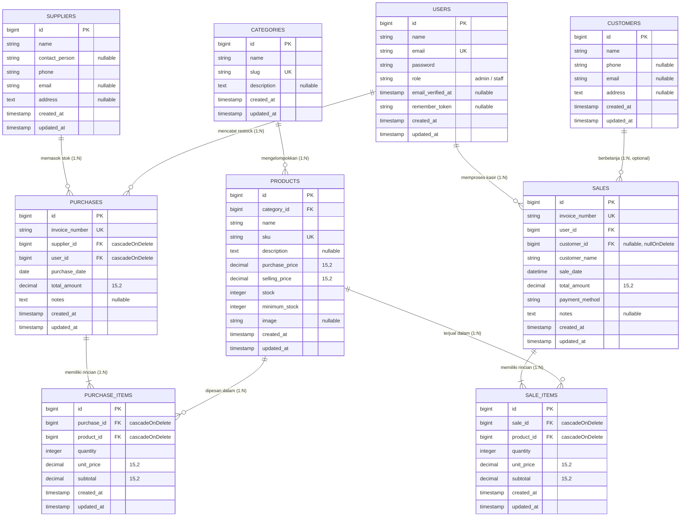

# 🌸 BlushBoutique — Inventory & Sales Management System

<p align="center">
  
  
  
  
  
</p>

---

## 📖 Tentang Aplikasi

**BlushBoutique** adalah aplikasi *Inventory & Sales Management* yang dirancang khusus untuk butik dan toko pakaian wanita. Mengusung tema visual antarmuka **Blush Pink & Pastel Soft** yang rapi, modern, dan feminin, aplikasi ini memadukan kemudahan operasional kasir harian (*Point of Sales*), manajemen stok pakaian multi-kategori, sistem restock pemasok (*supplier*), serta laporan keuangan laba kotor yang terperinci.

Selain dashboard operasional untuk pemilik dan staff, sistem ini juga menyediakan **Etalase Web Publik** yang dapat diakses oleh pengunjung **tanpa perlu login**, di mana pelanggan dapat menjelajahi koleksi busana dan melakukan pemesanan langsung melalui WhatsApp toko secara otomatis.

---

## ✨ Fitur-Fitur Utama

### 1. 🛍️ Katalog Publik untuk Pengunjung (Tanpa Login)
- **Akses Langsung (`/`)**: Pengunjung dapat melihat etalase koleksi pakaian tanpa harus mendaftar atau login.
- **Pencarian & Filter**: Cari busana berdasarkan nama, kode SKU, atau filter per kategori (*Floral Dresses*, *Blouses*, *Skirts*, *Knitwear*, *Hijabs*).
- **Indikator Ketersediaan Stok**: Status *Ready Stock*, *Sisa Sedikit*, atau *Habis Terjual*.
- **Pemesanan Otomatis via WhatsApp**: Setiap kartu produk dilengkapi tombol **"Pesan via WA"** yang otomatis mengarahkan ke nomor WhatsApp toko dengan pesan pemesanan yang sudah terformat rapi (Nama produk, SKU, dan harga resmi).
- **Profil Butik & Jam Buka**: Informasi lokasi showroom butik fisik dan jam layanan operasional.

### 2. 🔐 Autentikasi Berbasis Peran (*Role-Based Access Control*)
Dilindungi oleh middleware khusus [`RoleMiddleware`](app/Http/Middleware/RoleMiddleware.php):
- **👑 Admin / Pemilik**:
  - Mengelola seluruh Master Data (Kategori, Pemasok/Supplier, dan Produk Pakaian).
  - Menambah, mengubah, mengunggah foto, dan menghapus busana.
  - Mengakses Laporan Analisis Penjualan & Laba Kotor.
  - Mengakses Laporan Valuasi Nilai Persediaan Stok.
- **🛍️ Staff Kasir**:
  - Melakukan transaksi penjualan kasir (*Point of Sales*).
  - Melakukan transaksi pembelian/restock barang masuk dari supplier.
  - Melihat katalog produk dan ketersediaan stok pakaian.
  - Dibatasi secara ketat dari perubahan master data dan laporan laba (*403 Forbidden*).

### 3. 🔒 Logika Transaksi & Konsistensi Stok Ketat
- **Proteksi *Race Condition***: Seluruh proses penjualan (`sales`) dan restock (`purchases`) dibungkus dalam `DB::transaction` dan menggunakan `lockForUpdate()` pada baris produk di database.
- **Validasi Stok Otomatis**: Transaksi penjualan **otomatis ditolak** jika jumlah pembelian melebihi stok fisik yang tersedia di database.
- **Integritas Perhitungan di Sisi Server**: Total harga dan subtotal dihitung murni di server berdasarkan `selling_price` di database, bukan mempercayai input dari sisi browser client.
- **Sinkronisasi Stok**:
  - Transaksi Penjualan (`Sales`) $\rightarrow$ Mengurangi stok produk (`decrement`).
  - Transaksi Pembelian (`Purchases`) $\rightarrow$ Menambah stok produk (`increment`).

### 4. 📸 Manajemen Foto Busana
- Mendukung unggah foto produk pakaian format `JPG`, `PNG`, `WEBP`, dan `GIF` (maksimal 2 MB).
- Fitur **Pratinjau Langsung (*Live Image Preview*)** saat memilih berkas foto di form tambah/edit produk.
- Terhubung otomatis dengan symlink `public/storage`.
- Otomatis membersihkan/menghapus berkas foto lama saat produk diperbarui atau dihapus.

### 5. 📊 Dashboard Ringkas & Peringatan Stok Kritis
- **Kartu Metrik KPI**: Total Penjualan, Pendapatan Hari Ini, Total Unit Stok Busana, dan Nilai Aset Modal Inventory (Khusus Admin).
- **Tabel Peringatan Stok Menipis (*Low Stock Alert*)**: Mendeteksi dan menampilkan daftar pakaian yang stoknya berada di bawah atau sama dengan batas minimum stok (`stock <= minimum_stock`), lengkap dengan tombol *quick restock*.
- **Feed Riwayat Transaksi**: Menampilkan 5 penjualan kasir dan 5 pembelian stok terbaru.

### 6. 🌸 Master Data Pelanggan (Customers) & Integrasi Kasir
- **CRUD Pelanggan Lengkap**: Kelola basis data pelanggan tetap/member (Nama, No. Telepon/WA, Email, dan Alamat).
- **Halaman Profil & Analisis Belanja (`/customers/{customer}`)**: Halaman khusus profil pelanggan yang menampilkan:
  - Informasi kontak lengkap dengan tombol aksi 1-Klik chat WhatsApp (`wa.me`) dan kirim email.
  - Kartu metrik KPI pelanggan: Total Akumulasi Belanja (Rp), Total Frekuensi Transaksi Kasir, Total Unit Pcs Busana yang Dibeli, dan Nilai Rata-rata Belanja per Kunjungan.
  - Tabel riwayat seluruh faktur penjualan pelanggan dengan rincian busana yang dibeli dan tautan langsung ke cetak nota resmi.
  - Tombol aksi cepat **"Transaksi Kasir Baru"** yang otomatis mengaitkan pelanggan ke form kasir.
- **Integrasi Dropdown Kasir POS**: Form kasir penjualan dilengkapi pemilih pelanggan dengan sinkronisasi otomatis nama nota serta dukungan URL query parameter `?customer_id=...`.
- **Dukungan Pembeli Umum (*Walk-in Customer*)**: Kolom relasi bersifat `nullable` sehingga kasir tetap leluasa melayani pembeli langsung tanpa keharusan mendaftarkan akun pelanggan.
- **Badge Member & Riwayat Belanja**: Nota dan riwayat transaksi menampilkan status member dan riwayat total pembelian tiap pelanggan secara akurat.
- **Navigasi Terintegrasi Lintas Modul**: Tautan profil pelanggan disematkan langsung pada tabel riwayat penjualan, halaman faktur nota kasir, dan feed transaksi terbaru di dashboard utama.
- **Bebas Masalah N+1 Query**: Eager loading (`with(['customer', 'user', 'items.product'])`) diterapkan di seluruh daftar transaksi penjualan.

### 7. 📑 Laporan Keuangan & Valuasi Persediaan (Khusus Admin)
- **Laporan Penjualan & Laba**: Filter rentang tanggal, perhitungan omset kotor, estimasi Harga Pokok Penjualan (HPP / Modal), margin keuntungan, dan laba bersih.
- **Laporan Valuasi Stok**: Menghitung total nilai modal aset yang tertanam di toko dan estimasi potensi omset jika seluruh busana terjual.
- **Siap Cetak (*Print-Ready*)**: Tampilan nota kasir dan laporan sudah dioptimalkan dengan CSS media print.

---

## 🏛️ Arsitektur & Relasi Database (ERD)

Aplikasi **BlushBoutique** menggunakan basis data relasional ternormalisasi dengan integritas referensial yang ketat, menghubungkan master data pengguna (admin/staff), pelanggan (*customer*), kategori produk, supplier persediaan, stok busana, hingga transaksi kasir dan pembelian masuk.

### 1. 📊 Entity Relationship Diagram (ERD)

Diagram ERD interaktif berikut dirender otomatis menggunakan standar **Mermaid**:



---

### 2. 🗂️ Kamus Data & Relasi Entitas

| Nama Tabel | Peran Entitas | Foreign Key (FK) Terhubung | Integritas & Keterangan Relasi |
| :--- | :--- | :--- | :--- |
| **`users`** | Akun Staff Kasir & Admin Pemilik | - | `1:N` ke `sales` (kasir yang melayani) dan `purchases` (staff pencatat). |
| **`customers`** | Basis Data Pelanggan Setia / Member | - | `1:N` ke `sales` (`customer_id` bersifat `nullable`, `nullOnDelete`). Jika data member dihapus, riwayat penjualan tetap aman tersimpan. |
| **`categories`** | Klasifikasi Busana (*Dress, Blouse, dll*) | - | `1:N` ke `products` (`cascadeOnDelete`). |
| **`suppliers`** | Pemasok / Produsen Grosir Pakaian | - | `1:N` ke `purchases` (`cascadeOnDelete`). |
| **`products`** | Master Busana & Pengendali Stok Fisik | `category_id` $\rightarrow$ `categories.id` | Memiliki SKU unik. Terhubung ke transaksi melalui `sale_items` dan `purchase_items`. |
| **`sales`** | Faktur Transaksi Penjualan Kasir POS | `user_id` $\rightarrow$ `users.id`<br>`customer_id` $\rightarrow$ `customers.id` | Menyimpan nomor faktur unik (`SLS-YYYYMMDD-XXXXX`), metode pembayaran (Tunai, QRIS, Transfer, Debit), dan total nilai belanja. |
| **`sale_items`** | Detail Item Pakaian Terjual per Faktur | `sale_id` $\rightarrow$ `sales.id`<br>`product_id` $\rightarrow$ `products.id` | Menyimpan kuantitas, harga jual saat transaksi, dan subtotal per baris item busana. |
| **`purchases`** | Faktur Pembelian Stok Masuk (*Restock*) | `supplier_id` $\rightarrow$ `suppliers.id`<br>`user_id` $\rightarrow$ `users.id` | Mencatat transaksi pembelian grosir dari supplier ke gudang toko. |
| **`purchase_items`** | Detail Item Busana yang Direstock | `purchase_id` $\rightarrow$ `purchases.id`<br>`product_id` $\rightarrow$ `products.id` | Menampung kuantitas masuk, harga modal satuan, dan subtotal pembelian. |

---

### 3. 🛡️ Kebijakan Integritas Transaksi & Stok
1. **Otomatisasi Stok (*Inventory Consistency*)**:
   - Transaksi Penjualan (`sales` $\rightarrow$ `sale_items`) secara otomatis memanggil `Product::decrement('stock', $qty)`.
   - Transaksi Restock Masuk (`purchases` $\rightarrow$ `purchase_items`) secara otomatis memanggil `Product::increment('stock', $qty)`.
2. **Pencegahan Kondisi Balapan (*Race-Condition Lock*)**:
   - Seluruh mutasi stok dibungkus dalam `DB::transaction()` dan setiap baris produk dikunci dengan `Product::lockForUpdate()` saat validasi stok.
3. **Fleksibilitas Pelanggan**:
   - Kasir dapat memilih pelanggan member terdaftar untuk akumulasi statistik belanja, atau melayani pembeli langsung (*Walk-in Customer*) tanpa hambatan.
   - Kolom `customer_id` pada tabel `sales` menggunakan aturan `nullOnDelete()`, sehingga integritas riwayat keuangan toko tidak akan rusak jika sewaktu-waktu profil pelanggan dihapus.

---

## 🚀 Panduan Instalasi & Menjalankan Aplikasi

### 1. Prasyarat Sistem
- **PHP** versi 8.1 atau lebih tinggi (ekstensi `pdo_sqlite`, `curl`, `mbstring`, `openssl`, `fileinfo` aktif).
- **Composer** versi 2.x.

### 2. Langkah Pemasangan

1. **Buka Terminal / PowerShell** dan arahkan ke direktori project:
   ```bash
   cd "c:\safira\web toko pakaian\Blush_Boutique_Web"
   ```

2. **Pasang Dependensi Composer** (jika belum terpasang):
   ```bash
   composer install
   ```

3. **Konfigurasi Environment (`.env`)**:
   Pastikan konfigurasi database di file `.env` sudah sesuai (secara bawaan menggunakan SQLite yang siap pakai tanpa konfigurasi tambahan):
   ```ini
   APP_NAME="BlushBoutique"
   APP_URL=http://localhost:8000
   DB_CONNECTION=sqlite
   ```

4. **Jalankan Migrasi & Data Awal (Seeder)**:
   Perintah ini akan membuat seluruh tabel dan mengisi data awal akun demo, 5 kategori busana, 3 supplier, serta 10 koleksi pakaian awal:
   ```bash
   php artisan migrate:fresh --seed
   ```

5. **Hubungkan Symlink Penyimpanan Foto**:
   ```bash
   php artisan storage:link
   ```

6. **Jalankan Server Lokal Laravel**:
   ```bash
   php artisan serve --host=0.0.0.0 --port=8000
   ```

Aplikasi sekarang sudah berjalan dan dapat diakses melalui browser Anda!

---

## 🌐 Tautan & Kredensial Akun Pengujian (Demo)

Buka browser dan kunjungi alamat berikut:

| Akses Halaman | Tautan URL | Keterangan |
| :--- | :--- | :--- |
| **Etalase Publik** | [http://localhost:8000](http://localhost:8000) atau [http://127.0.0.1:8000](http://127.0.0.1:8000) | Dapat diakses pengunjung tanpa perlu login. |
| **Portal Login** | [http://localhost:8000/login](http://localhost:8000/login) atau [http://127.0.0.1:8000/login](http://127.0.0.1:8000/login) | Dilengkapi tombol 1-Klik Isi Kredensial Demo. |

### 🔑 Akun Demo:

1. **Admin / Pemilik Butik**:
   - **Email:** `admin@blushboutique.com`
   - **Password:** `password123`
   - *Hak Akses:* Dashboard Lengkap, Master Produk CRUD + Upload Foto, Master Kategori, Master Supplier, Laporan Penjualan & Laba, Laporan Valuasi Stok.

2. **Staff Kasir**:
   - **Email:** `staff@blushboutique.com`
   - **Password:** `password123`
   - *Hak Akses:* Transaksi Kasir Penjualan Baru, Transaksi Restock Pakaian Masuk, dan Melihat Daftar Stok Busana.

---

## 🧪 Pengujian Otomatis (*Automated Feature Testing*)

Proyek ini telah dilengkapi dengan unit & feature testing menyeluruh menggunakan PHPUnit:

```bash
php artisan test
```

### Hasil Pengujian:
```text
   PASS  Tests\Unit\ExampleTest
  ✓ that true is true

   PASS  Tests\Feature\BlushBoutiqueTest
  ✓ public catalog accessible without login
  ✓ public product detail page
  ✓ admin can login and access dashboard
  ✓ staff cannot access categories or reports (Security 403)
  ✓ sale transaction decrements stock and rejects insufficient stock
  ✓ purchase transaction increments stock
  ✓ admin can upload product with image

   PASS  Tests\Feature\CustomerTest
  ✓ authenticated user can view customers list
  ✓ authenticated user can view customer details
  ✓ can create new customer
  ✓ can update customer
  ✓ can delete customer
  ✓ sale transaction with registered customer
  ✓ sale transaction with walk in customer

   PASS  Tests\Feature\ExampleTest
  ✓ the application returns a successful response

  Tests:    16 passed (65 assertions)
```

---

## 🎨 Palet Warna Desain (Aesthetic Soft Pink)

- **Blush Rose Primary**: `#F27893` / `#E54D71`
- **Pastel Pink Background**: `#FDF7F8` / `#FDF2F4`
- **Soft Cream & Peach Accent**: `#FFF9F5` / `#FFF0F3`
- **Text & Luxury Slate**: `#372A31` / `#4A3B43`
- **Typography**: `Outfit` (Modern Clean Sans) & `Playfair Display` (Luxury Boutique Serif)

---

## 📄 Lisensi

Aplikasi ini dikembangkan untuk keperluan operasional **BlushBoutique**. Hak cipta &copy; 2026 BlushBoutique. All rights reserved.
